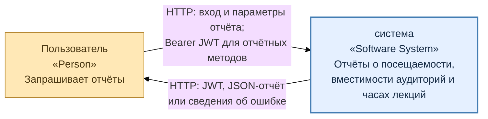
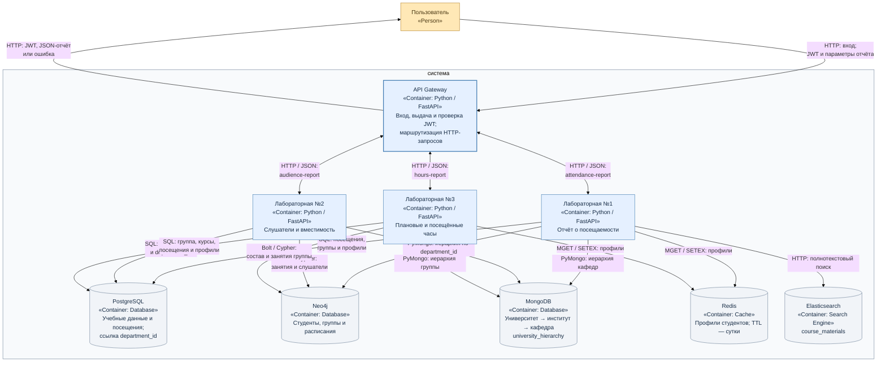
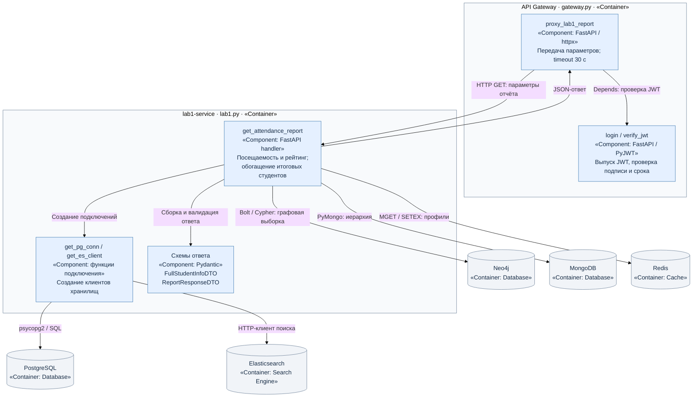
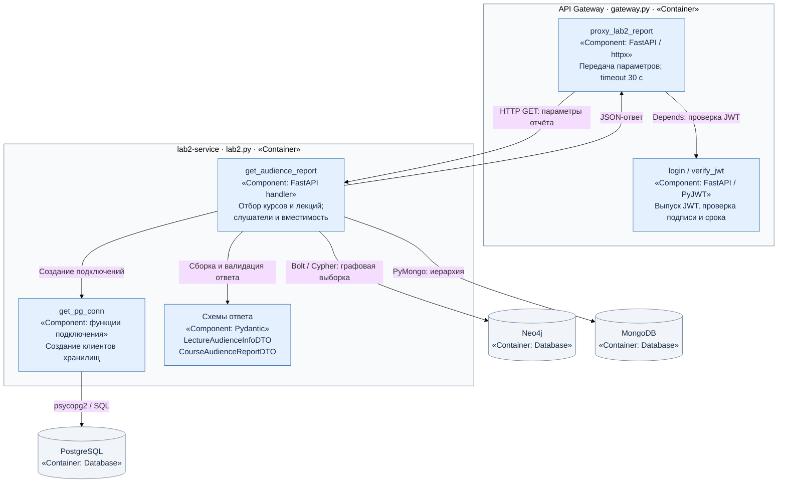
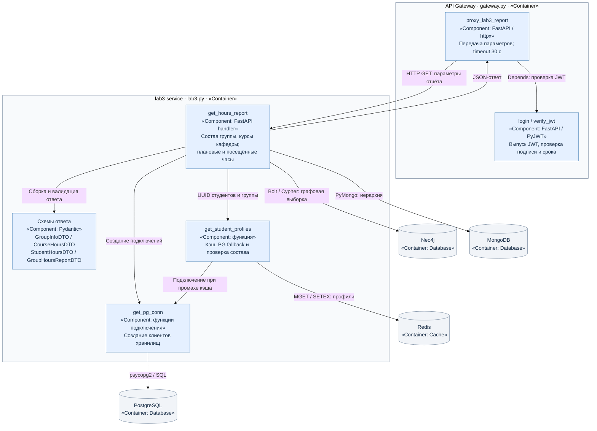

# C4 — Mermaid

Пять диаграмм: Context и Container общие для системы, Component отдельно для лабораторных №1–3. Уровень Code не включён. C4-представления выполнены средствами Mermaid flowchart со стереотипами и границами: без экспериментального C4-рендерера.

Показан требуемый сценарий доступа только через API Gateway. На контексте отдельно показаны запрос и ответ. Пользователь — единственный внешний актор; имя системы — «система». Хранилища входят в логическую систему; Compose разворачивает Gateway и лабораторные сервисы, но не сами БД. Прямоугольные границы не являются доказательством сетевой изоляции; код и Compose не менялись.

Component показывает реальные handlers, helpers и схемы Pydantic. Логические этапы расчёта включены в описание handler, а не превращены в выдуманные сервисы или классы. Хранилища на C3 — внешние для детализируемого контейнера зависимости, а не его компоненты. Запросы к БД на C2/C3 показаны как отношения использования: возвращаемые строки подразумеваются; полные потоки данных вынесены в DFD.

Актуальные DFD находятся в `../mermaid-dfd/DFD.md`. Старые draw.io и прежние Mermaid-файлы сохранены.

Иерархия `университет → институт → кафедра` и атрибуты подразделений хранятся только в MongoDB. В PostgreSQL остаются UUID `department_id` в учебных таблицах, без таблиц universities/institutes/departments и JOIN к ним.

## C1 — общий контекст

## C2 — общие контейнеры

## C3 — лабораторная №1

## C3 — лабораторная №2

## C3 — лабораторная №3

