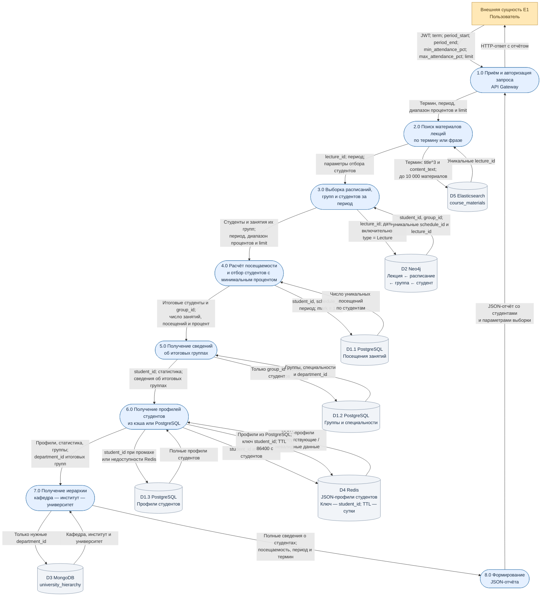
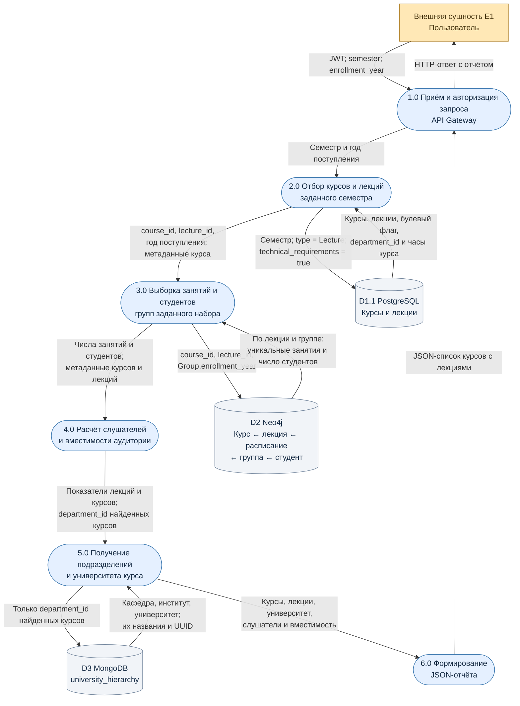
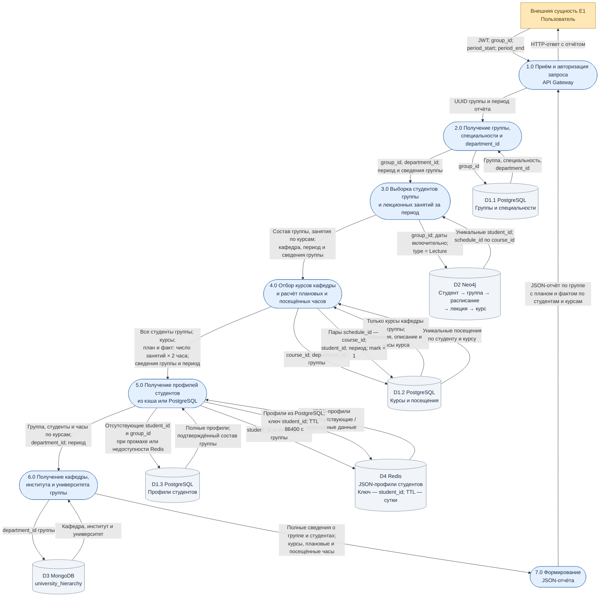

# DFD лабораторных №1–3 — Mermaid по согласованному примеру

Одна схема на лабораторную: `flowchart TB`, прямоугольная внешняя сущность, скруглённые процессы, цилиндры хранилищ и цвета из примера пользователя. Это согласованное оформление, не буквальные графические символы классической нотации Йордона–ДеМарко. C4 в draw.io не изменены.

Показан сценарий запроса отчёта с уже полученным JWT. Выдача токена, ошибки и ранние пустые ответы не развёрнуты: отдельные контексты и декомпозиции не добавлены. Ответ пользователю возвращается через API Gateway; сетевые настройки не изменялись.

D1.1/D1.2/D1.3 — логические области одной PostgreSQL, не отдельные экземпляры БД. Прямые стрелки к хранилищу включают параметры выборки, обратные — полученные данные, как в предоставленном образце.

- Лаба 1: процент относительно выбранных занятий группы; сортировка по проценту ASC, числу занятий DESC, UUID ASC, затем limit. Redis хранит карточки только итоговых студентов.
- Лаба 2: схема следует предоставленному примеру; иерархия извлекается только из MongoDB по department_id. Год — год поступления группы; вместимость — максимум размера одной участвующей группы. Повторные занятия не умножают слушателей; лекции без занятий/слушателей исключаются. Redis и Elasticsearch не используются.
- Лаба 3: специальные дисциплины определяются кафедрой курса; одна лекция равна двум академическим часам. Сохраняются студенты с нулевой посещаемостью; при отсутствии курсов их список курсов пуст. Elasticsearch не используется.
- Redis лаб 1/3: UUID → JSON, TTL 86400 секунд, fallback к PG при промахе/ошибке; запись обновлённых профилей показана отдельно.

Иерархия `университет → институт → кафедра` и атрибуты подразделений хранятся только в MongoDB. В PostgreSQL остаются UUID `department_id` в учебных таблицах, без таблиц universities/institutes/departments и JOIN к ним.

## Лабораторная №1

## Лабораторная №2

## Лабораторная №3

